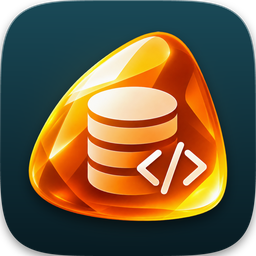
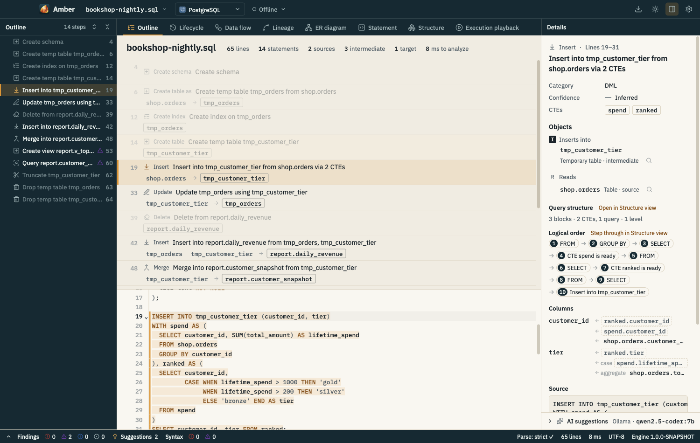
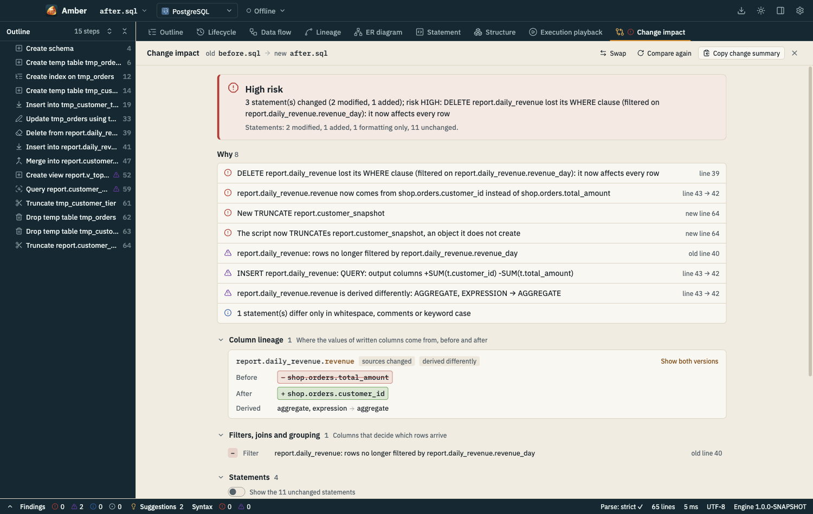
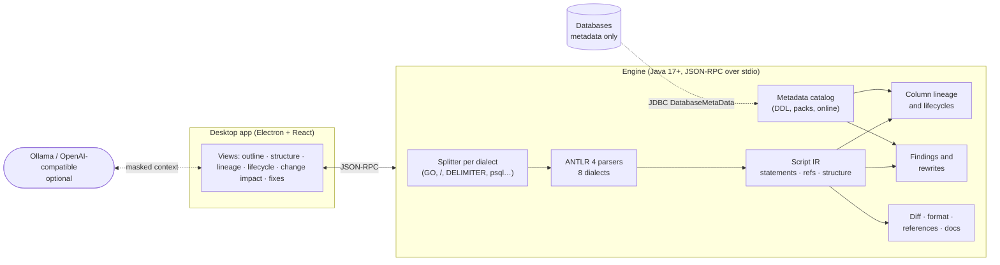
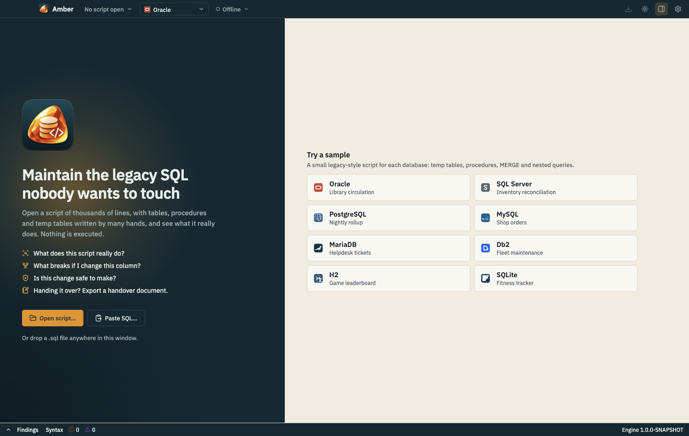
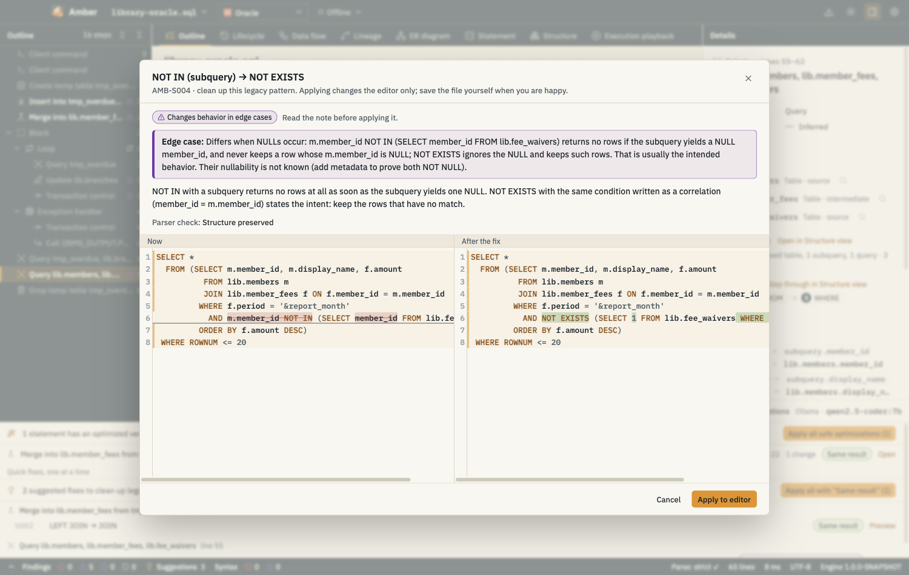

<p align="center">
  
</p>

<h1 align="center">Amber</h1>

<p align="center"><b>Maintain the legacy SQL nobody wants to touch.</b></p>

<p align="center">
  Amber is an open-source desktop app that reads the SQL scripts you inherited (thousands of lines of
  DDL, DML, temp tables and procedures written by many hands) and shows what they really do, where every
  column comes from, and whether your change is safe. It never runs your SQL.
</p>

<p align="center">
  <a href="https://github.com/paganini2008/amber/actions/workflows/ci.yml"></a>
  <a href="https://github.com/paganini2008/amber/releases/latest"></a>
  <a href="LICENSE"></a>
  
  
</p>

<p align="center">
  <a href="https://paganini2008.github.io/amber/">Website</a> ·
  <a href="https://github.com/paganini2008/amber/releases/latest">Download</a> ·
  <a href="docs/design.md">Design</a> ·
  <a href="docs/protocol.md">Engine protocol</a>
</p>



## Features

| The question you have | What Amber gives you |
|---|---|
| **What does this 3,000-line script actually do?** | An outline of every statement with a one-line summary, nested through procedures, blocks, IF and loops. |
| **Where does this column come from?** | Column lineage through CTEs, subqueries, temp tables and earlier statements to the base tables, with each transformation. |
| **What breaks if I change this table or column?** | Impact analysis downstream, plus *Find references* and *Go to definition* (F12) for tables, CTEs, procedures and columns. |
| **How is this monster query built, and in which order is it evaluated?** | Nested boxes of CTEs, UNION branches, derived tables and subqueries, and a step-through of the logical order: FROM → WHERE → GROUP BY → SELECT → ORDER BY. |
| **Which temp table is filled where?** | A lifecycle matrix and a data-flow graph showing which step creates, writes, reads and drops each object. |
| **Is my change safe?** | *Change impact* compares two versions: changed column sources, removed filters, new DROPs and new risks, ranked by risk. |
| **Which parts are risky or slow?** | 17 rules (LEFT JOIN turned INNER, NOT IN with NULLs, functions on indexed columns, row-by-row DML in loops…), with verified quick fixes. |
| **The layout is unreadable.** | A formatter that only changes whitespace and keyword case, and proves it token by token. |
| **I have to hand this over.** | A handover document (Markdown or HTML): purpose, objects, data flow, column origins, risks. |
| **Can AI help without leaking our schema?** | Optional Ollama or OpenAI-compatible suggestions, built from Amber's analysis with names masked, and every rewrite checked by the parser. |

Offline by default. An optional, read-only online mode reads table metadata (columns, keys, indexes)
from one or more databases to make every analysis more precise.

In English, Simplified Chinese or Spanish: the interface and the engine's own texts (statement summaries,
findings, change reasons, rewrite explanations, the handover document) follow Settings → Language.



## How it works



- The engine splits a script the way each database's client does, parses every statement with a
  dialect grammar, and builds one intermediate representation that all features share.
- Analysis is deterministic and static. Results inferred without metadata are labeled *possible*;
  metadata from DDL files, metadata packs or online mode upgrades them to *certain*.
- Nothing is executed: online mode only calls JDBC `DatabaseMetaData`, and AI output is parsed and
  compared, never run.

## Requirements

| To | You need |
|---|---|
| Use Amber | Nothing else. Each installer bundles the engine, a trimmed Java runtime and all JDBC drivers. Windows 10/11 x64, macOS 12+ (Apple silicon or Intel), Linux x64 (deb or rpm). |
| Build or run the engine yourself | JDK **17** or later (compiled for 17; CI and releases use 25), Maven **3.9+** |
| Build the desktop app | Node.js **22.12+** |
| Online mode (optional) | Network access to the database and an account that can read catalog metadata |
| AI suggestions (optional) | [Ollama](https://ollama.com), or an OpenAI-compatible API and a key |

**Supported databases**

| Database | Parser | Bundled JDBC driver |
|---|---|---|
| Oracle | grammars-v4 `sql/plsql` | Oracle JDBC (ojdbc11) |
| SQL Server | grammars-v4 `sql/tsql` | Microsoft JDBC Driver (mssql-jdbc) |
| PostgreSQL | grammars-v4 `sql/postgresql` + PL/pgSQL body parser | pgjdbc |
| MySQL | grammars-v4 `sql/mysql` | MySQL Connector/J |
| MariaDB | grammars-v4 `sql/mariadb` | MariaDB Connector/J |
| Db2 (LUW) | grammar written for Amber | IBM Data Server Driver for JDBC |
| H2 | grammar written for Amber | H2 |
| SQLite | grammars-v4 `sql/sqlite` | sqlite-jdbc |

## Quick start

### Install

Download the installer for your platform. These links always point to the latest release:

| Platform | File |
|---|---|
| Windows 10/11 (x64) | [Amber-windows-x64-setup.exe](https://github.com/paganini2008/amber/releases/latest/download/Amber-windows-x64-setup.exe) |
| macOS, Apple silicon | [Amber-macos-arm64.dmg](https://github.com/paganini2008/amber/releases/latest/download/Amber-macos-arm64.dmg) |
| macOS, Intel | [Amber-macos-x64.dmg](https://github.com/paganini2008/amber/releases/latest/download/Amber-macos-x64.dmg) |
| Linux (x64), Debian/Ubuntu | [Amber-linux-x64.deb](https://github.com/paganini2008/amber/releases/latest/download/Amber-linux-x64.deb) |
| Linux (x64), Fedora/RHEL/openSUSE | [Amber-linux-x64.rpm](https://github.com/paganini2008/amber/releases/latest/download/Amber-linux-x64.rpm) |

Checksums: [SHA256SUMS](https://github.com/paganini2008/amber/releases/latest/download/SHA256SUMS).

The installers are not code-signed yet:

- **macOS**: right-click Amber in Applications, choose **Open**, then **Open** again. If macOS reports
  the app as damaged, run `xattr -dr com.apple.quarantine /Applications/Amber.app`.
- **Windows**: in "Windows protected your PC", select **More info**, then **Run anyway**.
- **Linux**: `sudo apt install ./Amber-linux-x64.deb` or `sudo dnf install ./Amber-linux-x64.rpm`.

### First run

1. Start Amber and pick a sample on the start screen (one per database), or **Open script…**.
2. Choose the dialect in the title bar. The outline, findings and views appear in well under a second
   for typical scripts.
3. Select a statement and try **Structure → Logical order**, or put the cursor on a table and press
   **F12** / **Shift+F12**.



### From source, in one minute

```bash
mvn -B -q -f backend/pom.xml -DskipTests package
java -jar backend/amber-core/target/engine/engine.jar analyze nightly.sql --dialect postgresql
```

Input `nightly.sql`:

```sql
create temp table tmp_paid as
select customer_id, sum(amount) as total
  from sales.orders
 where status = 'PAID'
 group by customer_id;

insert into report.vip (customer_id, total)
select p.customer_id, p.total
  from tmp_paid p
  left join crm.blocked b on b.customer_id = p.customer_id
 where b.reason <> 'fraud';

drop table tmp_paid;
```

Output:

```text
nightly.sql  postgresql  14 lines  SUCCESS  244 ms

Outline
    0  L1     CREATE_TABLE_AS      Create temp table tmp_paid from sales.orders
    1  L7     INSERT               Insert into report.vip from tmp_paid, crm.blocked
    2  L13    DROP                 Drop temp table tmp_paid

Objects
  tmp_paid                                 TEMP_TABLE     INTERMEDIATE 0:CREATE 1:READ 2:DROP
  sales.orders                             TABLE          SOURCE       0:READ
  report.vip                               TABLE          TARGET       1:INSERT
  crm.blocked                              TABLE          SOURCE       1:READ

Findings
  MEDIUM  AMB-S002  L11    LEFT JOIN behaves as INNER JOIN
```

## Examples

The desktop app drives everything below; the same functions are available from the command line and
over the engine's JSON-RPC protocol ([docs/protocol.md](docs/protocol.md)), e.g. for CI checks.

### Analysis: outline, lineage, findings

```bash
java -jar engine.jar analyze nightly.sql --dialect postgresql --json > analysis.json
```

`analysis.json` holds the statements (with nested query `structure` and `executionOrder`), object
lifecycles, the column-lineage graph and findings. In the app: **Lineage** traces any column; the
**Findings** tab lists risks with their lines.

### Quick fixes: clean up a legacy pattern with proof

```json
→ {"jsonrpc":"2.0","id":1,"method":"rewrite.suggest","params":{"dialect":"postgresql","text":"select p.customer_id, p.total\n  from tmp_paid p\n  left join crm.blocked b on b.customer_id = p.customer_id\n where b.reason <> 'fraud';"}}
← {"rule":"AMB-S002","title":"LEFT JOIN → JOIN","safety":"EQUIVALENT","check":"STRUCTURE_PRESERVED", …}
```

```sql
select p.customer_id, p.total
  from tmp_paid p
  join crm.blocked b on b.customer_id = p.customer_id
 where b.reason <> 'fraud'
```

Every fix is applied, parsed and compared structurally before it is offered, and labeled *Same result*,
*Same result given the table definitions*, or *Changes behavior in edge cases* with the reason. In the
app: **Fix…** on a finding, or **Cmd/Ctrl+.** in the editor.



### Change impact: is this edit safe?

```json
→ {"method":"diff","params":{"dialect":"postgresql",
     "before":{"text":"delete from sales.orders where status = 'CANCELLED';\ninsert into report.t (id, amt) select id, amount from sales.orders;"},
     "after": {"text":"delete from sales.orders;\ninsert into report.t (id, amt) select id, net_amount from sales.orders;"}}}
← risk HIGH
   HIGH   FILTER_REMOVED         DELETE sales.orders lost its WHERE clause (filtered on sales.orders.status): it now affects every row
   HIGH   COLUMN_SOURCE_CHANGED  report.t.amt now comes from sales.orders.net_amount instead of sales.orders.amount
```

In the app: **File → Compare with the saved file** (⇧⌘D), or drop a second version on the window.
**Copy change summary** gives Markdown for the ticket or pull request.

### Formatting: readable again, provably unchanged

```json
→ {"method":"format","params":{"dialect":"oracle","text":"select o.id,o.amount,c.name from orders o join customer c on c.id=o.customer_id where o.status='PAID' and o.amount>100 -- big ones\norder by o.amount desc;"}}
```

```sql
SELECT o.id, o.amount, c.name
FROM orders o
JOIN customer c ON c.id = o.customer_id
WHERE o.status = 'PAID'
    AND o.amount > 100 -- big ones
ORDER BY o.amount DESC;
```

A statement whose tokens or comments would change in any way is kept as written and reported.
In the app: **Shift+Alt+F** (script) or **Cmd/Ctrl+K Cmd/Ctrl+F** (selection).

### Handover document

```bash
java -jar engine.jar doc nightly.sql --dialect postgresql --html --out nightly-handover.html
```

```markdown
# nightly.sql — handover notes
| Dialect | PostgreSQL |
| Statements | 3 (1 dml, 2 ddl) |
| Sources | `sales.orders`, `crm.blocked` |
| Targets | `report.vip` |
## What the script does
1. Create temp table tmp_paid from sales.orders — line 1–5
1. Insert into report.vip from tmp_paid, crm.blocked — line 7–11
…
```

### Best practices for legacy scripts

- **Read before you edit:** Outline first, then Structure → *Logical order* on the statements you
  will touch, then *Find references* on every table you change.
- **Add metadata for certainty:** import the DDL files or connect online (read-only); findings and
  lineage marked *possible* become *certain*.
- **Close every change with Change impact:** compare with the saved file before you commit.
- **Keep AI on a leash:** leave *Mask identifiers* on, add your constraints as notes, and treat every
  answer by its check label: *Structure preserved* is not proof of equal results.

## Configuration

Users configure Amber in **Settings** (connections, AI providers, formatting, theme). Developers can
set defaults in two git-ignored files, each with a committed `.env.example`; variables in the shell
win over the files, and a packaged app reads neither. Database connections and API keys for the app are
always entered in Settings and stored encrypted by the OS keychain, never in a `.env`.

**Engine: `backend/.env`**

| Property | Default | Description |
|---|---|---|
| `AMBER_PARSER_THREADS` | CPUs (min 2) | Threads that parse statements in parallel |
| `AMBER_RPC_THREADS` | CPUs (min 2) | Threads that serve JSON-RPC requests |
| `AMBER_JDBC_TIMEOUT_SECONDS` | 15 | Login, network and metadata-call timeout in online mode |
| `AMBER_DB_DEADLINE_SECONDS` | 45 | Hard deadline per data source in online mode, also for servers that never answer |
| `AMBER_FINDINGS_SECONDS` | 60 | Time budget for the checks of one script; past it, AMB-I003 marks where checking stopped |
| `AMBER_CORPUS_TIMEOUT_SECONDS` | 60 | Per-file parse timeout of the corpus integration test |
| `OPENAI_API_KEY` | — | Enables the optional real-model test `LlmIT` |
| `AMBER_IT_OPENAI_BASE_URL` | `https://api.openai.com/v1` | Endpoint for `LlmIT` |
| `AMBER_IT_OPENAI_MODEL` | `gpt-4.1-mini` | Model for `LlmIT` |

**Desktop app (development): `ui/amber-desktop/.env`**

| Property | Default | Description |
|---|---|---|
| `AMBER_ENGINE_JAR` | `../../backend/amber-core/target/engine/engine.jar` | Engine jar to run |
| `AMBER_JAVA` | `$JAVA_HOME/bin/java`, else `java` | Java 17+ executable |
| `AMBER_ENGINE_MAX_RESTARTS` / `AMBER_ENGINE_RESTART_WINDOW_SEC` | 5 / 60 | Engine crash restarts allowed per window |
| `AMBER_DEV_CDP_PORT` | off | Chrome DevTools Protocol port for scripted UI checks |
| `AMBER_LOG_LEVEL` | `info` | `off`, `error`, `info` or `debug` |
| `AMBER_DEFAULT_OLLAMA_URL` | `http://localhost:11434` | Initial Ollama URL in Settings |
| `AMBER_DEFAULT_OPENAI_URL` | `https://api.openai.com/v1` | Initial OpenAI-compatible URL in Settings |
| `AMBER_DEFAULT_AI_TIMEOUT_SEC` | 120 | Initial AI answer timeout |
| `AMBER_UPDATE_REPO` | `paganini2008/amber` | Repository the update check reads |
| `AMBER_UPDATE_TIMEOUT_SEC` | 10 | Update check timeout |
| `AMBER_MAX_FILE_MB` | 64 | Largest script the app opens |

**Integration tests with real databases (optional):**
`backend/amber-core/src/test/resources/online-it.properties` (git-ignored; see the `.example` next to
it) lists test connections and tables for `OnlineMetadataIT`; fixture DDL is in
`backend/amber-core/src/test/resources/online-fixtures/`.

## Performance

Measured on an Apple M2 Max, macOS, JDK 25, warm engine, from the project's own test suites:

| Workload | Size | Time |
|---|---|---|
| Parse + analyze the PostgreSQL corpus | 243 files · 77,924 lines | ~0.9 s |
| Parse + analyze the SQL Server corpus | 164 files · 12,682 lines | ~7 s |
| Parse + analyze the Oracle corpus | 209 files · 4,510 lines | ~3–4 s |
| Change impact between two script versions | 5,250 lines · 1,750 statements | ~0.35 s |
| Format two scripts | 2 × 5,000 lines (Oracle, T-SQL) | ~0.16 s |

Corpus parse rate is 100 % for all 8 dialects apart from 8 documented expected failures (syntax newer
than the grammars or invalid for the database's own client).

**How Amber compares with the tools you may already use**

| | Amber | SQL IDEs (DataGrip, DBeaver…) | Lineage / visualizers | Linters (SQLFluff…) |
|---|---|---|---|---|
| Whole multi-statement scripts, procedures, temp tables | ✓ | partly | partly | ✓ |
| Column lineage across statements and temp tables | ✓ | — | ✓ | — |
| Change impact between two versions | ✓ | text diff | — | — |
| Verified quick fixes | ✓ | partly | — | partly |
| Works offline, never runs SQL | ✓ | needs a connection to run | varies | ✓ |
| Execution plans | — by design | ✓ | — | — |

Trade-offs: static analysis cannot see data, so some results are *possible* until metadata confirms
them; the logical order is how SQL is defined, not the database's actual plan; very new syntax may parse
only with fallback mode.

## Documentation

- [Website](https://paganini2008.github.io/amber/): overview and screenshots
- [Design document](docs/design.md): goals, architecture, analyses and rules
- [Engine protocol](docs/protocol.md): JSON-RPC methods and result shapes, CLI
- [Third-party notices](THIRD-PARTY-NOTICES.md)

**FAQ**

- *Does Amber connect to my database?* Only if you turn on online mode, and then only to read catalog
  metadata through JDBC `DatabaseMetaData`; it sends no SQL of its own and never yours.
- *A statement fails to parse.* Turn on **Settings → Analysis → Allow fallback parsing**: the rest of the
  script is analyzed and the statement is shown as *Partial*. Please open an issue with a minimal,
  anonymized example.
- *Is my code sent to an AI provider?* Only when you press Send, after a preview, with names and
  literals masked by default.
- *Where are my passwords and keys?* Encrypted by the operating system's keychain, in the app's main
  process; they never reach the UI or logs.

## Contributing & License

Build and test everything:

```bash
mvn -B -f backend/pom.xml verify          # engine: unit tests, corpus, integration tests, coverage gate
cd ui/amber-desktop && npm ci && npm run typecheck && npm run lint && npm test && npm run dev
```

- **Issues:** bug reports with a minimal, anonymized SQL example and the dialect are the most useful.
  Never attach real business SQL or data.
- **Pull requests:** keep the engine coverage gate green (90 %+ line coverage outside generated
  grammars), add a corpus file for parser changes, and keep UI text in English.
- **Releases:** pushing a tag `v1.2.3` builds and publishes installers for all platforms; the
  repository itself stays at `1.0.0-SNAPSHOT`.

```
backend/              Maven build, Java 17+
  amber-core/         engine: splitters, parsers, IR, lineage, findings, rewrites, diff, format, JSON-RPC, CLI;
                      unit tests (*Test) and integration tests (*IT: corpus, online mode, real-model AI)
ui/amber-desktop/     Electron + React + TypeScript desktop app
docs/                 GitHub Pages site, design document, engine protocol
.github/              CI, release and Pages workflows, runtime build scripts
```

Amber is licensed under the [Apache License 2.0](LICENSE). Bundled third-party components and their
licenses are listed in [THIRD-PARTY-NOTICES.md](THIRD-PARTY-NOTICES.md).
